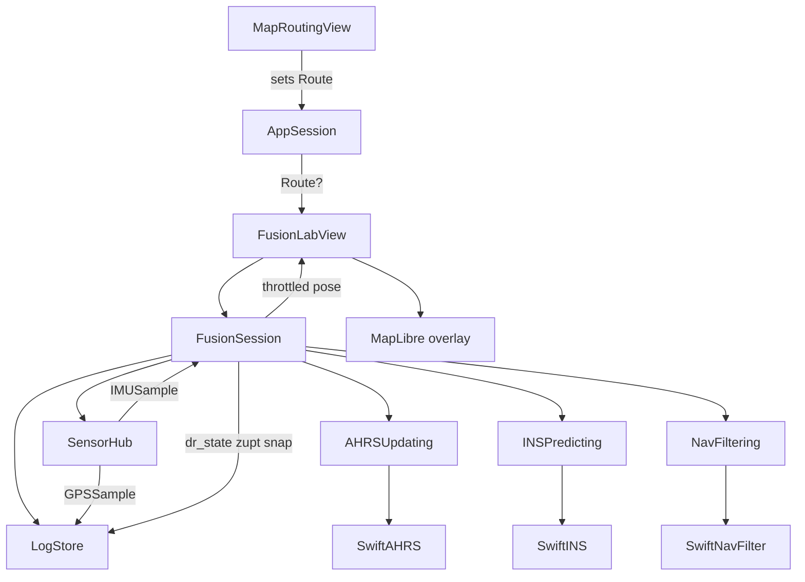

# Design · feature-fusion-ekf

## Architecture Overview



**Stack:** Swift / SwiftUI / MapLibre / Core Motion (via SensorHub) / existing LogStore JSONL.

**Invariant:** GPS never enters NavFilter position updates. GPS only feeds LogStore (and optional UI `gps_track`).

## Data Models

```text
FusionConfig (tunables, defaults below)
  imuPredict: every sample
  uiLogHz: 10
  corridorHalfWidthMeters: 80
  alongTrackWindowMeters: 200
  zuptAccelMaxG: 0.08
  zuptGyroMaxRadPerSec: 0.05
  zuptMinDurationSec: 0.4
  snapLogResidualMeters: 5
  initialAlongTrackSigmaMeters: 30
  initialCrossTrackSigmaMeters: 5
  initialSpeedSigmaMps: 3
  initialHeadingSigmaRad: 0.5

NavState
  x, y            // meters in local ENU tangent frame anchored at route A
  v               // m/s along body / planar speed
  psi             // heading rad (ENU yaw)
  s               // arc length along route meters
  P               // diagonal or small covariance (σ_s, σ_ct, σ_v, σ_psi) — M0 may keep diagonal σ vector
  timestamp

SnapResult
  projectedENU / latLon
  s
  residualMeters  // distance before snap
  alongTrackDelta

ZUPTEvent / SnapEvent — for logging + UI badges
```

**Local frame:** ENU origin = first route coordinate (A). Convert WGS84 ↔ ENU with a small pure helper (haversine / local tangent). Route polyline stored as cumulative `s` + ENU points once at session start.

**Heading when mag untrusted:** AHRS integrates gyro from last trusted heading; if never trusted since init, seed from first segment tangent. Mag updates heading only when `magTrusted == true` (soft-reject otherwise).

## API Design

```text
protocol AHRSUpdating {
  mutating func reset(initialHeadingRad: Double)
  mutating func predict(imu: IMUSample, dt: TimeInterval)
  var headingRad: Double { get }
  var attitude: simd_quatd { get }
}

protocol INSPredicting {
  mutating func reset(originENU: SIMD2<Double>, headingRad: Double)
  mutating func predict(imu: IMUSample, headingRad: Double, dt: TimeInterval)
  var positionENU: SIMD2<Double> { get }  // x east, y north
  var speedMps: Double { get }
}

protocol NavFiltering {
  mutating func reset(route: RouteGeometry, initial: NavState)
  mutating func predict(from ins: INSPredicting, headingRad: Double, dt: TimeInterval) -> NavState
  mutating func applyZUPTIfNeeded(imu: IMUSample, config: FusionConfig) -> ZUPTEvent?
  /// Hard project onto route corridor; grows σ when residual large.
  mutating func projectToRoute(config: FusionConfig) -> SnapResult
  var state: NavState { get }
}

@MainActor
final class FusionSession: ObservableObject {
  init(ahrs: AHRSUpdating, ins: INSPredicting, nav: NavFiltering, config: FusionConfig, ...)
  func start(hub: SensorHub, logStore: LogStore, route: Route) throws
  func stop()
  @Published var lastNav: NavState?
  @Published var gpsTrack: [CLLocationCoordinate2D]
  @Published var drTrack: [CLLocationCoordinate2D]
  @Published var banner: String?
  @Published var isRunning: Bool
}

@MainActor
final class AppSession: ObservableObject {
  @Published var lastRoute: Route?
}
```

**LogStore extensions**

- Keep GPS gate on `start` (unchanged).
- Add append API used only while recording, e.g. `appendEncodedLine(_ line: String)` or typed helpers:
  - `LogEventEncoder.drStateLine(...)`, `zuptLine(...)`, `snapLine(...)`
- FusionSession calls these on the throttle path / event path. IMU/GPS lines still come from LogStore’s hub subscriptions.

**JSONL (new types)**

| type | Min fields |
|---|---|
| `dr_state` | ts, s, v, psi, lat, lon, sigS, sigV, sigPsi |
| `zupt` | ts, durationSec? |
| `snap` | ts, residualM, s |

## Component Breakdown

| Component | Role |
|---|---|
| `AppSession` | Holds last successful `Route` from Map Routing |
| `RouteGeometry` | Polyline + cumulative `s` + ENU cache; nearest-in-window project |
| `SwiftAHRS` / `SwiftINS` / `SwiftNavFilter` | Default protocol impls |
| `FusionSession` | Wire hub → layers → log/UI throttle |
| `FusionLabView` | Start/Stop, banners, MapLibre: route / gps_track / dr_track |
| `FusionConfig` | Tunables |
| `LogEventEncoder` + `LogStore` | New line types + append |
| Lab list | Link «Fusion EKF» under new section |
| MapRoutingView | On successful Build, `appSession.lastRoute = route` (environment object) |

## Design Decisions

| Decision | Choice | Why |
|---|---|---|
| Layering | AHRS → INS → NavFilter + protocols | Brief approach 3B; future FFI |
| GPS in filter | Never | Hard GPS-denied for DR proof |
| Snap policy | Always project in along-track window; ↑σ; log snap | Session continuity for research |
| UI shell | Dedicated FusionLab | Avoid god-view in MapRouting/LogLab |
| Route handoff | AppSession | Simple; Start gated |
| Log coupling | Extend LogStore | One JSONL dual-track file |
| Predict rate | Every IMU; UI/log 10 Hz | Fidelity vs file size |
| Covariance M0 | Diagonal σ vector | Enough for UI + prompts later |

**Alternatives rejected:** monolithic `FusionEngine` (harder FFI boundary); dual log files; GPS soft-update in this feature.

## Non-Functional Requirements

- Doxygen + ASD-STE100 English on public types/methods (project rule).
- Fusion math on a background queue or synchronous in IMU callback with MainActor hop only for `@Published` / log append scheduling — do not block UI.
- No secrets; no new background modes.
- Unit-testable pure geometry / ZUPT / encoder without device.
- Manual device verify optional on Xcode machine (same as prior Lab features).

## Defaults (starting values)

Documented in `FusionConfig`; may change after first lab runs without breaking JSONL schema:

- `uiLogHz = 10`
- `corridorHalfWidthMeters = 80` (informational cross-track; project still snaps)
- `alongTrackWindowMeters = 200`
- ZUPT: accel 0.08 g, gyro 0.05 rad/s, min 0.4 s
- `snapLogResidualMeters = 5` (always snap; log event when residual ≥ this)
