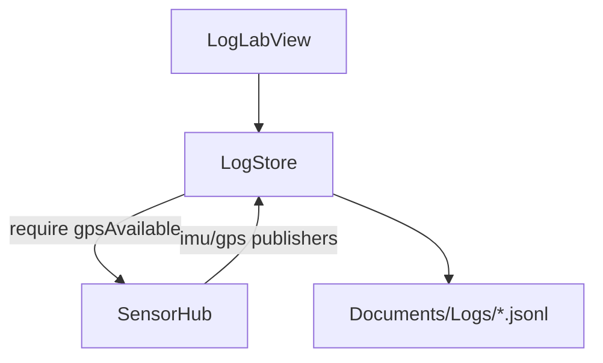

# Design · feature-log-store

## Architecture Overview



## Data Models / Schema

One JSON object per line. Common field: `type`, `ts` (ISO8601 or epoch ms — **prefer epoch ms Double** for compact research logs).

| type | Fields (min) |
|---|---|
| `meta` | sessionId, appVersion, startedAt |
| `route` | coordinates `[[lon,lat],…]` (optional) |
| `imu` | ax,ay,az, gx,gy,gz, heading?, magTrusted |
| `gps` | lat, lon, hAcc, speed?, course? |
| `end` | reason: `user_stop` \| `gps_lost` |

Filename: `session-yyyyMMdd-HHmmss.jsonl`.

## API Design

```text
@MainActor
final class LogStore: ObservableObject {
  var isRecording: Bool
  var lastErrorBanner: String?
  func start(hub: SensorHub, routeCoordinates: [CLLocationCoordinate2D]?) throws
  func stop(reason: EndReason)
  func listSessions() -> [URL]
  static var logsDirectory: URL
}
enum EndReason { case userStop, gpsLost }
```

- Start throws / returns false if `!hub.gpsAvailable`.
- Monitor `hub.$lastGPSFixAge` / `gpsAvailable` while recording.
- Append lines on a background writer queue; flush periodically.

## Component Breakdown

| Component | Role |
|---|---|
| `LogStore` | Gate, file IO, subscriptions |
| `LogEventEncoder` | Pure JSON encode for unit tests |
| `LogLabView` | UI + ShareLink / Share sheet |
| Lab list link | Next to Sensor Hub |

## Design Decisions

| Decision | Choice | Why |
|---|---|---|
| Format | JSONL | Stream-friendly research logs |
| GPS lost | Hard stop | Clean dual-track evaluation |
| Stop log vs hub | Independent | Sensor meters can continue |

## Non-Functional

- Doxygen + ASD-STE100 English docs.
- No secrets in logs.
