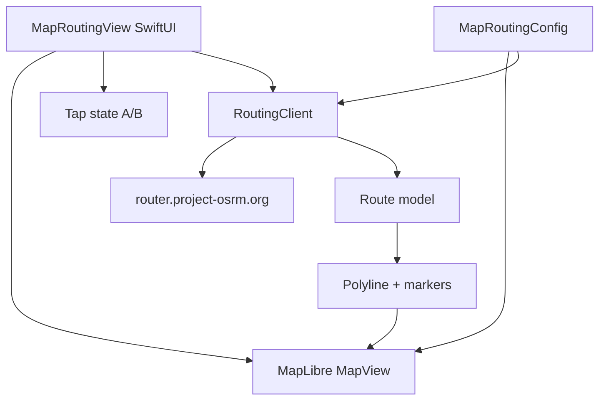

# Design · feature-map-routing

## Architecture Overview



**Стек:** SwiftUI + MapLibre Native (SPM) + URLSession; тайли [OpenFreeMap liberty](https://tiles.openfreemap.org/styles/liberty).

## Data Models

```text
Route
  coordinates: [CLLocationCoordinate2D]
  distanceMeters: Double
  durationSeconds: Double
  legs: [RouteLeg]

RouteLeg
  steps: [RouteStep]

RouteStep
  name: String?
  distanceMeters: Double?
  durationSeconds: Double?
  maneuverType / modifier (optional strings)
  coordinate: CLLocationCoordinate2D?  // maneuver location if present
```

OSRM JSON парситься один раз; сирий JSON не SoT.

## API Design

**External:** `GET /route/v1/driving/{lon1},{lat1};{lon2},{lat2}?overview=full&geometries=polyline&steps=true`

**Internal:** `RoutingClient.route(from:to:) async throws -> Route`  
Errors: `RoutingError.network | http | emptyRoutes | decode`.

## Component Breakdown

| Компонент | Роль |
|---|---|
| `MapRoutingConfig` | OSRM base URL, style URL, default center (Kyiv) |
| `RoutingClient` | HTTP + parse + polyline decode |
| `MapRoutingView` | UI: map, taps, Clear/Build, metrics, alerts |
| `MapLibre` wrapper | UIViewRepresentable (або офіційний SwiftUI bridge якщо є) |
| Navigation | Lab entry з root → `MapRoutingView` (замість/поруч placeholder) |

## Design Decisions

| Рішення | Вибір | Чому |
|---|---|---|
| Tiles | OpenFreeMap | free, no key, UA OSM |
| OSRM host | public demo | lab speed; self-host later |
| Steps in model now | yes | avoid second API contract for EKF/landmarks |
| Tap replace | Clear required | predictable lab UX |
| SPM MapLibre | distribution repo | official iOS binary |

## Non-Functional

- Cancel in-flight request on Clear / new Build (task id / generation).
- No secrets in repo.
- Attribution: MapLibre default for OpenFreeMap.
