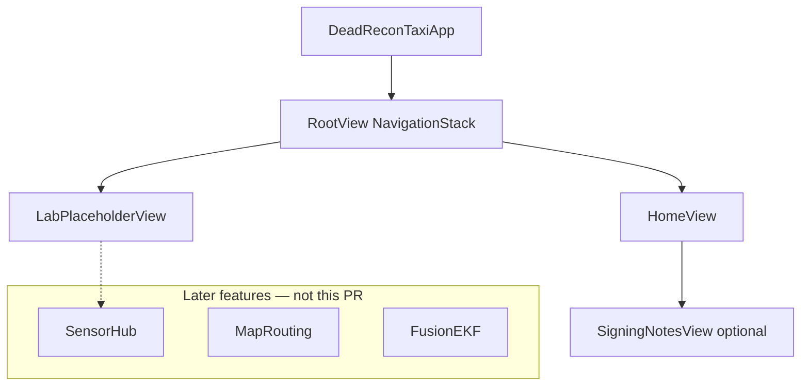

# Design · feature-project-infrastructure

## Architecture Overview

Мінімальний single-target iOS додаток: SwiftUI `App` → root `NavigationStack` → placeholder екрани. Немає мережі, карти, fusion.



**Стек:** Swift 5.9+ / SwiftUI; Xcode project у репо (не SPM-only app).  
**Чому не Flutter:** locked decision — pure iOS для max IMU.

## Data Models

Немає персистентних моделей. Можливі лише UI-константи (назва додатку, короткий текст про Developer Mode).

## API Design

Зовнішніх API немає. Внутрішньо: стандартна SwiftUI навігація (`NavigationLink` / `navigationDestination`).

## Component Breakdown

| Компонент | Відповідальність |
|---|---|
| `DeadReconTaxiApp` | `@main`, WindowGroup |
| `RootView` | NavigationStack, список входів |
| `HomeView` | Назва продукту, статус «Lab M0 shell» |
| `LabPlaceholderView` | Заглушка під майбутню lab-сесію |
| `SigningNotesView` (опційно) | Короткі кроки Trust / Developer Mode / 7-day renew |
| Xcode target | Bundle ID, deployment target, Info.plist keys |
| `docs/dev/ios-device-setup.md` | Нотатка для людини (не в UI обовʼязково) |

**Каталоги (пропозиція)**

```text
DeadReconTaxi/
  DeadReconTaxi.xcodeproj/
  DeadReconTaxi/
    App/DeadReconTaxiApp.swift
    Features/Home/HomeView.swift
    Features/Lab/LabPlaceholderView.swift
    Resources/Info.plist  # або GENERATE_INFOPLIST_FILE + keys in build settings
  docs/dev/ios-device-setup.md
```

## Design Decisions

| Рішення | Вибір | Альтернатива | Чому |
|---|---|---|---|
| Проєкт | Xcode app target у git | Лише Swift Package | Потрібен Run на device / entitlements |
| UI | SwiftUI | UIKit | Швидший shell, достатньо для lab |
| Модулі | Monolith target | SPM packages зараз | YAGNI до появи SensorHub/Fusion |
| Permissions text | Додати strings зараз | Відкласти до sensor-hub | Уникаємо блоку при першому sensor PR |
| Підпис | Automatic + Personal Team | Paid program | Lab на free Apple ID |

## Non-Functional Requirements

- **Security:** не зберігати секрети; немає мережевих ключів у цій фічі.
- **Reliability:** cold start → Home без crash.
- **Perf:** N/A beyond normal launch.
- **Privacy:** usage strings чесні (навігація / інерційна оцінка позиції для lab).

## Implementation notes (for later plan)

1. `xcodegen` опційно; якщо немає — створити проєкт через Xcode CLI або закомітити `.xcodeproj` згенерований локально.
2. Capability: Location When In Use — можна не вмикати до sensor-hub; достатньо usage strings.
3. Не додавати MapLibre SPM у цій фічі.
