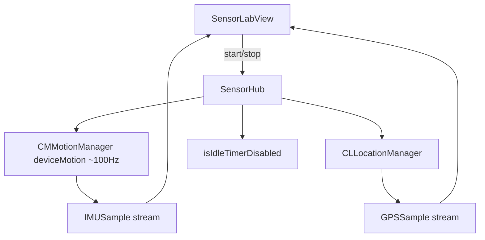

# Design · feature-sensor-hub

## Architecture Overview



## Data Models

```text
IMUSample
  timestamp: Date
  attitude: (pitch, roll, yaw) or quaternion — pick quaternion + Euler for UI
  userAcceleration: SIMD3<Double>  // g
  rotationRate: SIMD3<Double>      // rad/s
  headingDegrees: Double?
  headingAccuracy: Double
  magTrusted: Bool

GPSSample
  timestamp: Date
  coordinate: CLLocationCoordinate2D
  altitude: Double?
  horizontalAccuracy: Double
  speed: Double?
  course: Double?
```

**Invariant:** never merge IMU+GPS into one untagged sample struct.

## API Design

```text
final class SensorHub: ObservableObject (or actor + MainActor UI bridge)
  func start() throws
  func stop()
  var isRunning: Bool
  var gpsAuthorized: Bool
  var lastGPSFixAge: TimeInterval?
  // Combine: PassthroughSubject / CurrentValueSubject
  var imuPublisher: AnyPublisher<IMUSample, Never>
  var gpsPublisher: AnyPublisher<GPSSample, Never>
```

- `deviceMotionUpdateInterval = 0.01`
- Location: `desiredAccuracy = kCLLocationAccuracyBestForNavigation` (or Best)
- Mag: `magTrusted = (headingAccuracy >= 0 && headingAccuracy < threshold)` — threshold e.g. 25° (document constant)

## Component Breakdown

| Component | Role |
|---|---|
| `SensorHub` | Own motion + location managers; idle timer |
| `IMUSample` / `GPSSample` | Typed streams |
| `MagTrust` helper | Pure function for unit tests |
| `SensorLabView` | Meters UI + Start/Stop + GPS banner |
| Lab list link | Next to MapLibre entry |

## Design Decisions

| Decision | Choice | Why |
|---|---|---|
| Device Motion vs raw | Device Motion ~100 Hz | Max useful IMU with Apple bias handling |
| Logging | Not in this feature | log-store; skip file if no GPS (lab policy) |
| Sleep | Disable idle timer while running | Foreground lab without screen lock |
| Location denied | IMU-only + banner | Still spike IMU |

## Non-Functional

- Doxygen + ASD-STE100 English comments (project rule).
- No secrets; no background entitlement in v1.
