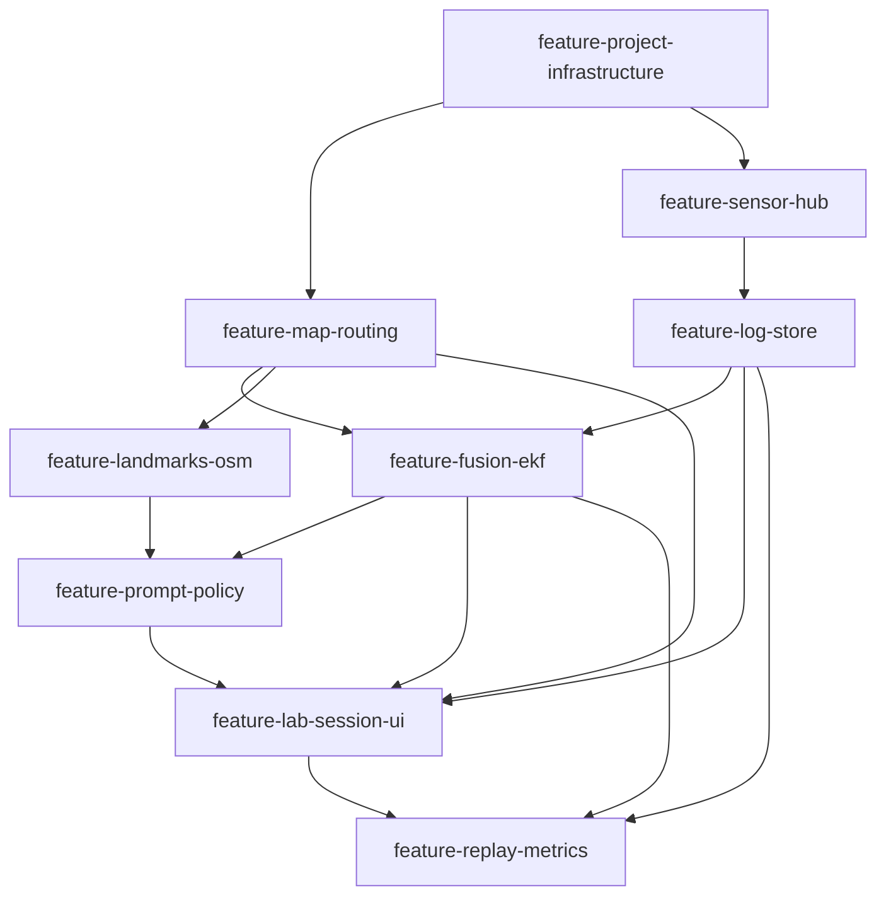

# DeadReconTaxi · Feature Map

**Статус:** Чернетка · design brief approved (chat) · formal `docs/ai/` lifecycle docs — наступний крок  
**Дата:** 2026-10-10  
**Джерело:** brainstorm + brainstorming design brief (Lab M0)

> Кожна фіча нижче — окремий AI DevKit `dev-lifecycle`: worktree/branch `feature-<name>` і
> фази `docs/ai/{phase}/YYYY-MM-DD-feature-<name>.md`. Залежності = що має існувати до старту,
> не спільний розклад.

---

## 1. Огляд

iOS-додаток навігації A→B (Україна) з **route-constrained dead reckoning**: коли GPS слабкий або
відсутній усю дорогу, позиція тримається на дорожньому графі OSM за рахунок max-rate IMU
(Core Motion), snap до маршруту, орієнтирів (світлофори OSM) і рідких питань юзеру.
Lab M0 доводить гіпотезу через **dual-track** (`gps_track` ∥ `dr_track`), replay і метрики —
не повний Waze-UX.

**Архітектурні принципи**

- Pure iOS (Swift/SwiftUI); Android — після доказу DR.
- Карти/граф: OSM + MapLibre + OSRM (не Apple Maps / не Google Maps у M0).
- Online ok для M0; офлайн-регіон — пізніше.
- GPS — окремий лог і опційний вимір з gate; режим GPS-denied у фільтрі для оцінки.
- Fusion — Swift EKF з чистою межею під можливий C++/Rust пізніше.
- Світлофори: `highway=traffic_signals` (+ опційно `crossing=traffic_signals`) у буфері маршруту.

**Спільний стек (M0)**

| Компонент | Рішення |
|---|---|
| Мова / UI | Swift / SwiftUI |
| Карта | MapLibre Native iOS |
| Роутинг | OSRM (публічний/легкий хост → свій пізніше) |
| Дані орієнтирів | OSM Overpass / extract уздовж полілінії |
| Сенсори | Core Motion (max-rate) + Core Location (GPS лог) |
| Fusion | Swift route-constrained EKF |
| Тест на девайсі | Free Apple ID (7-денний підпис) |

---

## 2. Граф залежностей

Умовність: `A --> B` = **B залежить від A**.

**Базові:** `feature-project-infrastructure`  
**Хвиля Lab M0 (порядок старту):** infrastructure → map-routing ∥ sensor-hub → log-store → fusion-ekf ∥ landmarks-osm → prompt-policy → lab-session-ui → replay-metrics  
**Листова для M0 success:** `feature-replay-metrics`

---

## 3. Реєстр фіч — Lab M0

### ID: `feature-project-infrastructure`

- **Опис:** Xcode/SwiftUI каркас додатку, підпис Personal Team, дозволи Location/Motion, базова навігація екранів.
- **Залежності:** —
- **Пріоритет:** High
- **Статус:** Merged to `master` (`bf06d3e`)
- **Ключове:** App target; Info.plist usage strings; Developer Mode notes; порожній shell під модулі.

### ID: `feature-map-routing`

- **Опис:** MapLibre карта; вибір A/B; запит маршруту до OSRM; полілінія + базова геометрія маршруту для snap.
- **Залежності:** `feature-project-infrastructure`
- **Пріоритет:** High
- **Статус:** Merged (`2be3f83` / PR #1) — manual verify still on Xcode machine
- **Ключове:** `RoutingClient`; відображення маршруту; помилка якщо OSRM недоступний (не стартувати сесію).

### ID: `feature-sensor-hub`

- **Опис:** Max-rate Core Motion (attitude, user accel, gyro, heading з soft-gate на mag) + окремий потік CLLocation для GPS.
- **Залежності:** `feature-project-infrastructure`
- **Пріоритет:** High
- **Статус:** Planned
- **Ключове:** цільова частота (spike 50–100 Hz); background constraints задокументовані; GPS ніколи не змішується з IMU в одному «зліпленому» семплі без міток джерела.

### ID: `feature-log-store`

- **Опис:** Запис сесії: IMU, GPS (окремо), події (prompt/landmark), маршрут id/полілінія; експорт для replay.
- **Залежності:** `feature-sensor-hub`
- **Пріоритет:** High
- **Статус:** Planned
- **Ключове:** dual-track ready schema (`gps_*` vs `dr_*` / events); детермінований replay input.

### ID: `feature-fusion-ekf`

- **Опис:** Route-constrained EKF (стан уздовж маршруту: progress `s`, `v`, ψ / bias); snap; GPS update з gate; режим GPS-denied.
- **Залежності:** `feature-map-routing`, `feature-log-store`
- **Пріоритет:** High
- **Статус:** Planned
- **Ключове:** чистий Swift API `predict` / `update_*`; mag soft-reject у авто; ZUPT на зупинках (підготовка під світлофори).

### ID: `feature-landmarks-osm`

- **Опис:** Індекс світлофорів уздовж маршруту (`highway=traffic_signals`, опційно `crossing=traffic_signals`); проєкція на `s`.
- **Залежності:** `feature-map-routing`
- **Пріоритет:** High
- **Статус:** Planned
- **Ключове:** буфер полілінії; онлайн Overpass для M0; нерівномірне покриття → не єдине джерело корекції.

### ID: `feature-prompt-policy`

- **Опис:** Політика питань юзеру (ближче до X/Y; точка 1/2/3) при високій коваріації / розвилці; відповідь → update фільтра.
- **Залежності:** `feature-fusion-ekf`, `feature-landmarks-osm`
- **Пріоритет:** High
- **Статус:** Planned
- **Ключове:** великі кнопки; бажано на зупинці / низькій швидкості; лог питання+відповіді.

### ID: `feature-lab-session-ui`

- **Опис:** Мінімальний UI lab-сесії: старт/стоп, overlay маршруту + `gps_track` + `dr_track`, маркери світлофорів, статус GPS/σ, екран prompt.
- **Залежності:** `feature-map-routing`, `feature-fusion-ekf`, `feature-log-store`, `feature-prompt-policy`
- **Пріоритет:** High
- **Статус:** Planned
- **Ключове:** треки різними кольорами; GPS і DR ніколи як один змішаний трек.

### ID: `feature-replay-metrics`

- **Опис:** Replay того самого EKF по логу; метрики: cross/along-track vs GPS (коли є), % часу на правильному ребрі, дрейф між корекціями, ефект prompts.
- **Залежності:** `feature-log-store`, `feature-fusion-ekf`, `feature-lab-session-ui`
- **Пріоритет:** High
- **Статус:** Planned
- **Ключове:** детермінований replay; екран/таблиця після заїзду; fixture-тести на записаному логу.

---

## 4. Backlog (після M0)

| ID | Нотатка |
|---|---|
| `feature-offline-region` | Завантажений регіон UA + локальний граф/роутер |
| `feature-self-hosted-osrm` | Власний OSRM замість публічного |
| `feature-nav-shell` | Повноцінне ведення / turn hints (не lab) |
| `feature-fusion-native-core` | Винести EKF у C++/Rust FFI за потреби |
| `feature-android-port` | Після доказу DR на iOS |
| `feature-voice-prompts` | Голосові уточнення позиції |
| `feature-traffic-eta` | Живий трафік / ETA (окремий провайдер) |

---

## 5. Success Lab M0

На міському заїзді з рідким або вимкненим GPS у фільтрі DR тримається на маршруті завдяки
snap + світлофори + 1–3 prompts; dual-track дає чисельні метрики відносно GPS-логу (якщо супутник
писався) або proxy (утримання на ребрі / дрейф між корекціями).

---

## 6. Non-goals M0

Android; офлайн-карти; App Store / TestFlight на платному акаунті; повний Waze-UX; голос;
трафік/ETA; ідеальне покриття світлофорів поза містами; повний порт ArduPilot EKF.
